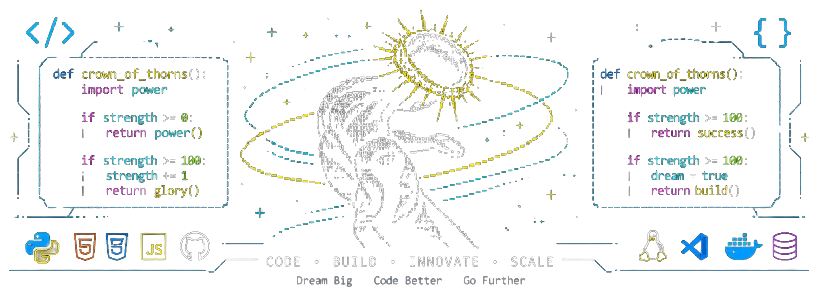

  

<h1>Codekage of the Byte</h1>

  

  

  

<em>“What doesn't break my code only makes me a better developer.”</em>

## <h2 padding="34"> HELLO WORLD </h2>

### 👨‍💻 *Who I am?*
A Software Engineering student at ISI, passionate about building web applications, developing software solutions, working with data, and exploring AI-powered development tools.

### 🧩 *What else?*
I enjoy learning new technologies, solving technical problems, and turning ideas into functional applications. My current focus is strengthening my skills in Python, JavaScript, SQL, backend development, API integration, and AI-assisted software development.

### 🧪 *What now?*
Sharpening my skills in **Bash**, **Linux**, **Python**, **JavaScript**, **Machine Learning**, and **Docker**. I'm also improving my design skills with **Figma**, while expanding my knowledge of **Codex**, **Cursor**, **n8n**, and **WordPress**.

### 🌀 *My Nindo*
Write clean shit. Grind like Elon. Keep building solutions. Find the One Piece.

 

  

 

## <h2>Let's Connect</h2>

  
  &nbsp;&nbsp;&nbsp;
  
  &nbsp;&nbsp;&nbsp;
  
  &nbsp;&nbsp;&nbsp;
  

## <h2>Tech Stack</h2>

<h3 align="center">🌐 Web Development</h3>

  
   
  
  

<h3 align="center">💻 Programming Languages</h3>

  

<h3 align="center">🗄️ Database & Version Control</h3>

  

<h3 align="center">🤖 AI & Development Tools</h3>

  
  
  
    
  

<h3 align="center">⚙️ Backend, DevOps & Data</h3>

  

  
  

<h3 align="center">🎨 Design & Productivity</h3>

  
    
  
  
  

---

  <i>🚀 Junior Developer | Always Learning, Always Building.</i>

<h2 align="center">📊 GitHub Stats</h2>

<h2 align="center">📈 Activity Graph</h2>

  

### 
<h2 align="center">⌘ Commit Activity</h2>

<picture>
  <source media="(prefers-color-scheme: dark)"
    srcset="https://raw.githubusercontent.com/midnightshady/midnightshady/output/pacman-contribution-graph-dark.svg">

  <source media="(prefers-color-scheme: light)"
    srcset="https://raw.githubusercontent.com/midnightshady/midnightshady/output/pacman-contribution-graph.svg">

  

<h2 align="center">⌘ Philosophy</h2>

  

<!-- Proudly created with GPRM ( https://gprm.itsvg.in ) -->
